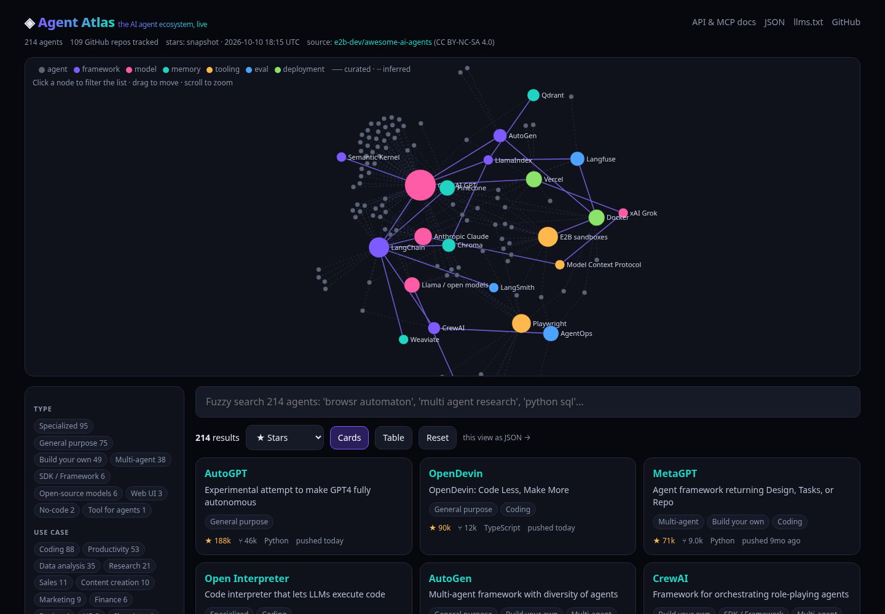
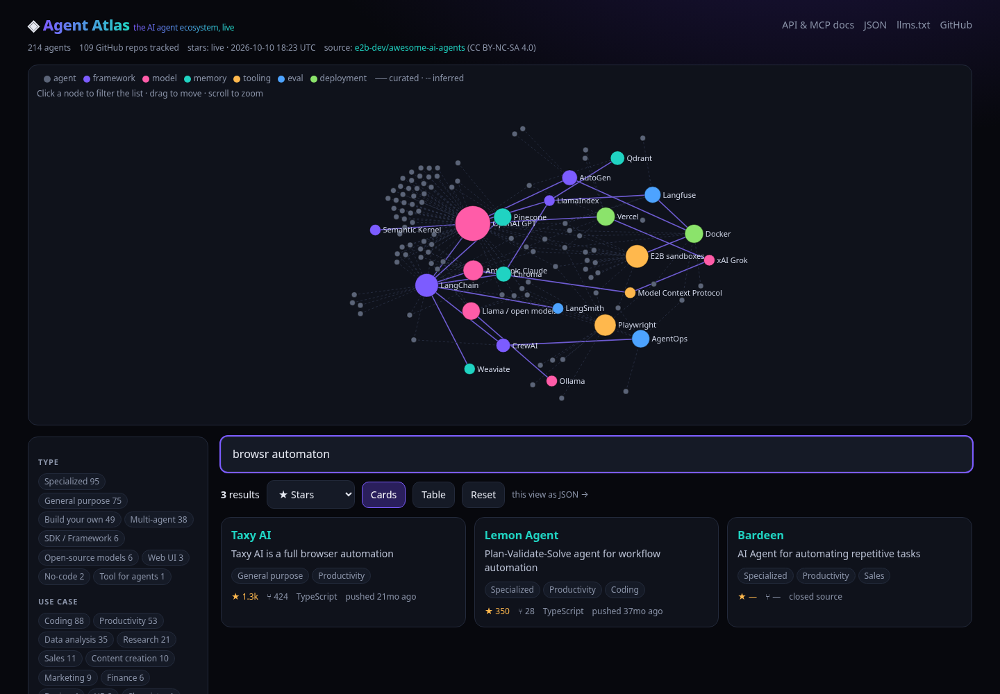
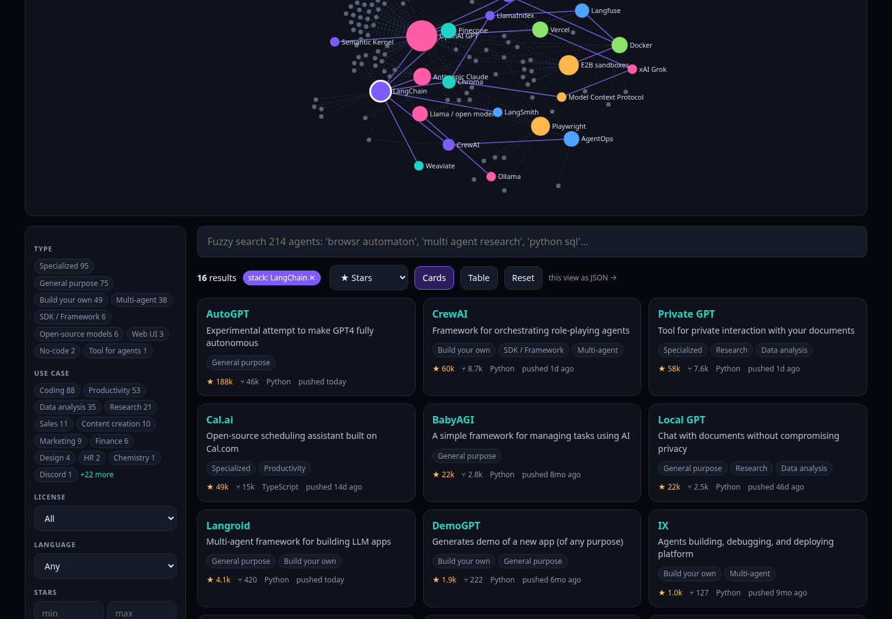

# ◈ Agent Atlas

**The AI agent ecosystem, live.** 214 AI agents and agent frameworks with live GitHub stars, fuzzy search, multi-filter, an interactive stack graph, a JSON API, and an MCP server so agents can query it too.

**Live:** https://agent-atlas-kohl.vercel.app · **API docs:** [/docs](https://agent-atlas-kohl.vercel.app/docs) · **OpenAPI:** [/api/openapi.json](https://agent-atlas-kohl.vercel.app/api/openapi.json) · **llms.txt:** [/llms.txt](https://agent-atlas-kohl.vercel.app/llms.txt)



## What's better than a plain awesome list

| | awesome-ai-agents (source) | Agent Atlas |
|---|---|---|
| Format | 5,600-line Markdown | Structured `data/agents.json` + refresh script |
| Stars | none | Live GitHub stars, forks, language, last commit (6h cache, snapshot fallback) |
| Search | Ctrl-F | Fuzzy search (typo-tolerant) + filter by type, use case, OSS/closed, language, star range; 5 sort orders; card/table views |
| Relations | none | Interactive stack graph: framework → model → memory/vector DB → tooling/browser → eval/observability → deployment. Click a node to filter |
| Machines | none | REST JSON API, OpenAPI 3.1, `/llms.txt`, MCP server (`search_agents`, `get_agent`, `get_stack`) |
| Freshness | manual | Weekly GitHub Action re-parses the source and refreshes stats |




## API

```bash
curl 'https://agent-atlas-kohl.vercel.app/api/agents?useCase=Coding&oss=true&minStars=10000&sort=stars&limit=5'
curl  https://agent-atlas-kohl.vercel.app/api/agents/autogpt
curl  https://agent-atlas-kohl.vercel.app/api/categories
curl  https://agent-atlas-kohl.vercel.app/api/graph?agents=false
```
Params for `/api/agents`: `q, category, useCase, oss, language, minStars, maxStars, tool (stack tool id), sort (stars|forks|recent|name), limit, offset`.

## MCP server (agent-friendly)

Stateless Streamable HTTP endpoint at `/api/mcp`.

```bash
claude mcp add --transport http agent-atlas https://agent-atlas-kohl.vercel.app/api/mcp
```

## Grok tool calling (xAI function calling)

```python
import json, requests
from openai import OpenAI  # xAI is OpenAI-compatible
client = OpenAI(base_url="https://api.x.ai/v1", api_key="$XAI_API_KEY")
ATLAS = "https://agent-atlas-kohl.vercel.app/api/mcp"
tools = [{"type": "function", "function": {
  "name": "search_agents",
  "description": "Search the AI agent ecosystem catalog with live GitHub stars.",
  "parameters": {"type": "object", "properties": {
    "q": {"type": "string"}, "useCase": {"type": "array", "items": {"type": "string"}},
    "oss": {"type": "boolean"}, "minStars": {"type": "number"}, "limit": {"type": "number"}}}}}]

def call_atlas(name, args):
    r = requests.post(ATLAS, json={"jsonrpc": "2.0", "id": 1, "method": "tools/call",
                                   "params": {"name": name, "arguments": args}})
    return r.json()["result"]["content"][0]["text"]

msgs = [{"role": "user", "content": "Best open-source coding agents with 10k+ stars?"}]
resp = client.chat.completions.create(model="grok-4-fast", messages=msgs, tools=tools)
for tc in resp.choices[0].message.tool_calls or []:
    msgs += [resp.choices[0].message, {"role": "tool", "tool_call_id": tc.id,
             "content": call_atlas(tc.function.name, json.loads(tc.function.arguments))}]
print(client.chat.completions.create(model="grok-4-fast", messages=msgs, tools=tools).choices[0].message.content)
```
All three tool schemas are on [/docs](https://agent-atlas-kohl.vercel.app/docs).

**Ask Grok (in-app):** `POST /api/ask` runs this loop server-side, **only when `XAI_API_KEY` is set** on the deployment. It is not set today, so the feature is disabled and says so. Nothing is simulated.

## Data
- `data/agents.json`: id, name, url, repo, description, category, useCases, openSource, pricing (open source vs commercial; no price data in the source), tags, mentions, links.
- `data/stack-relations.json`: curated stack tools + edges. Agent→tool edges are **inferred** from keyword mentions in the source text and shown dashed; they are not verified.
- `data/stats-snapshot.json`: GitHub stats snapshot used if the live API is unavailable.
- Refresh: `GITHUB_TOKEN=... npm run refresh` (or `--offline` to re-parse the cached README).

## Develop
```bash
npm ci && npm run dev        # http://localhost:3000
npm test && npm run typecheck && npm run build
```
Env (server only, optional): `GITHUB_TOKEN` (live stars via GraphQL; without it the snapshot is served), `XAI_API_KEY` (enables Ask Grok).

## Attribution & license
- Agent data adapted from [e2b-dev/awesome-ai-agents](https://github.com/e2b-dev/awesome-ai-agents) by E2B and contributors, licensed [CC BY-NC-SA 4.0](https://creativecommons.org/licenses/by-nc-sa/4.0/). Changes: parsed to JSON, categories normalized, GitHub stats and stack relations added. The derived data stays CC BY-NC-SA 4.0 (non-commercial, share-alike).
- Code: MIT. Not affiliated with E2B.

## Release note
Built on request from Andrew Crosby, sign-off on record **Sat Oct 10 2026, 11:14 AM PT**:
> "build the dopest version possible: fork or create a new enhanced GitHub repo for AI agent ecosystem. Make it include live star counts via API, advanced search/filter by category/use case, interactive graph of how tools connect in a stack, JSON API for data, perhaps a web UI demo using Vercel or similar if possible. Integrate any relevant Grok tools or make it agent-friendly. Report back with the repo link and key improvements."

New repo instead of a fork: the source is a single Markdown list; this project is a different app (Next.js + data pipeline + API), and a fork would tie it to upstream's README-only structure. Full release note: [RELEASE.md](RELEASE.md).

RANDYLAND/tech.
